# Full-Custom 4-Bit Arithmetic Logic Unit (ALU) in 90nm CMOS

A complete transistor-level, full-custom **4-Bit Arithmetic Logic Unit (ALU)** designed, simulated, and physically laid out in **Cadence Virtuoso** using the **90nm Generic PDK (`gpdk090`)**. 

This project follows an industry-standard **bottom-up hierarchical custom IC design flow**:
1. **Leaf-Cell Design & Sizing:** Transistor-level schematic capture, testbench creation, and physical layout (with Euler-path diffusion sharing) for all primitive CMOS and Transmission Gate (TG) cells.
2. **1-Bit Bit-Slice Integration (`ALU_1Bit`):** Combining arithmetic, bitwise logic, and an 8x1 multiplexer tree into a reusable 84-transistor bit-slice.
3. **4-Bit Top-Level Datapath (`ALU_4Bit`):** Cascading four 1-bit slices (336 transistors total) with ripple-carry chaining and zero-transistor inter-slice shift routing.
4. **Physical Verification:** Full layout implementation in **Virtuoso Layout Suite XL** verified with **Assura DRC** (Design Rule Check) and **Assura LVS** (Layout Versus Schematic).

---

## 1. Technology & Circuit Specifications

| Parameter | Specification |
| :--- | :--- |
| **EDA Tool Suite** | Cadence Virtuoso Schematic Editor L, ADE L (Spectre), Layout Suite XL |
| **Physical Verification** | Cadence Assura DRC & LVS |
| **Technology Library** | `gpdk090` (90nm CMOS Process — `nmos1v` & `pmos1v` 1.2V core devices) |
| **Supply Voltage ($V_{DD}$)** | $1.2\text{ V}$ (`VSS` = $0\text{ V}$) |
| **Gate Length ($L$)** | $100\text{ nm}$ (uniform across all transistors) |
| **Baseline Inverter Sizing** | $W_n = 240\text{ nm}$, $W_p = 480\text{ nm}$ ($W_p/W_n = 2:1$ for symmetric switching threshold $V_M = 0.6\text{ V}$) |
| **Total Transistor Count** | **84 Transistors** per 1-Bit ALU Slice / **336 Transistors** for Top-Level 4-Bit ALU |

---

## 2. Instruction Set Architecture (3-Bit Opcode)

The ALU executes **8 arithmetic, bitwise logical, and shift operations** selected via a shared 3-bit control bus (`S2, S1, S0`):

| Opcode (`S2 S1 S0`) | Operation | Mathematical Function | Active Datapath Hardware |
| :---: | :--- | :--- | :--- |
| **`000`** | **Addition** | $\text{ALU\_Out} = A + B + C_{in}$ (`Cin = 0`) | 28T Mirror Full Adder (`FA_Mirror_28T`) |
| **`001`** | **Subtraction (2's Comp.)** | $\text{ALU\_Out} = A + \overline{B} + 1$ (`Cin = S0 = 1`) | 28T Mirror Full Adder + Conditional `XOR2_TG` on $B$ |
| **`010`** | **Bitwise AND** | $\text{ALU\_Out} = A \cdot B$ | 6T Static CMOS AND Gate (`AND2_CMOS`) |
| **`011`** | **Bitwise OR** | $\text{ALU\_Out} = A + B$ | 6T Static CMOS OR Gate (`OR2_CMOS`) |
| **`100`** | **Bitwise XOR** | $\text{ALU\_Out} = A \oplus B$ | 6T Transmission Gate XOR (`XOR2_TG`) |
| **`101`** | **Bitwise NOT** | $\text{ALU\_Out} = \overline{A}$ | 2T Static CMOS Inverter (`INV_1X`) |
| **`110`** | **Logical Shift Left** | $\text{ALU\_Out} = A \ll 1$ (`Out[i] = A[i-1]`) | Inter-Slice Shift Routing into MUX Channel `D6` |
| **`111`** | **Logical Shift Right** | $\text{ALU\_Out} = A \gg 1$ (`Out[i] = A[i+1]`) | Inter-Slice Shift Routing into MUX Channel `D7` |

---

## 3. End-to-End Design & Verification Flow

```text
Phase 1: Leaf-Cell Schematics  -->  INV_1X, AND2_CMOS, OR2_CMOS, XOR2_TG, MUX_2x1_TG, MUX_8x1_TG, FA_Mirror_28T
         & Spectre Testbenches
                  |
                  v
Phase 2: Hierarchical Datapath -->  1-Bit ALU Slice (ALU_1Bit) --> 4-Bit Cascaded ALU (ALU_4Bit)
         Assembly & Simulation      (80 ns All-Opcode Sweep)       (Multi-Bit Vector Verification)
                  |
                  v
Phase 3: Leaf-Cell Layout XL   -->  Standard-Cell Pitch Alignment, Euler-Path Diffusion Sharing,
         & Assura DRC / LVS         Integrated/Detached Substrate Taps (M1_NWELL, M1_PSUB)
                  |
                  v
Phase 4: Hierarchical Macro    -->  ALU_1Bit Macro Floorplanning --> ALU_4Bit Top-Level Tiling
         Placement & Routing        (Metal1 / Metal2 Routing)        (DRC & LVS Clean)
```

---

## 4. Module-by-Module Design, Simulation & Layout

### 4.1 Static CMOS Inverter (`INV_1X` — 2 Transistors)
* **Circuit Design:** Sized with $W_p = 480\text{ nm}$ (`pmos1v`) and $W_n = 240\text{ nm}$ (`nmos1v`) at $L = 100\text{ nm}$ to equalize pull-up hole mobility and pull-down electron mobility. Serves as the `101` Bitwise NOT unit, select-line inverter ($\overline{S_0}, \overline{S_1}, \overline{S_2}$), and output buffer.
* **Testbench Verification:** Verified using a `vpulse` input toggling between $0\text{ V}$ and $1.2\text{ V}$ with $50\text{ ps}$ rise/fall times, confirming sharp rail-to-rail inversion.
* **Physical Layout:** Designed in Layout XL with vertically aligned polysilicon gates, horizontal `Metal1` power rails (`VDD` top, `VSS` bottom), and integrated body ties (`/S//B/VDD/` and `/S//B/VSS/`).

| Inverter Schematic | Inverter Testbench |
| :---: | :---: |
| 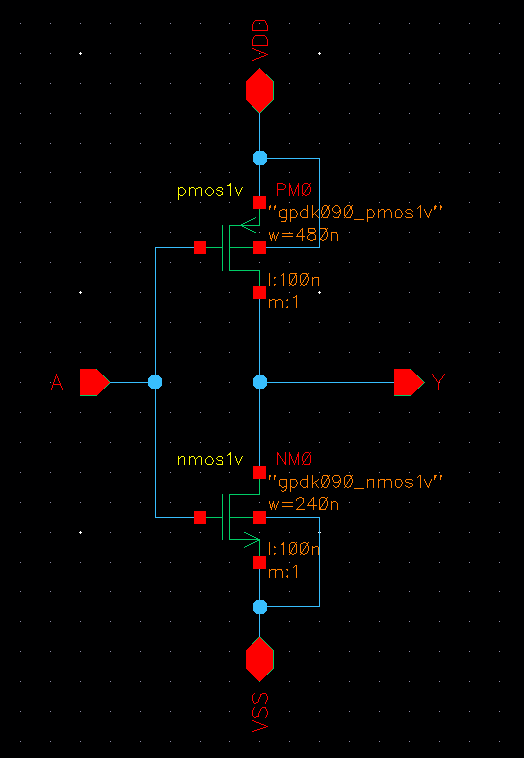 | 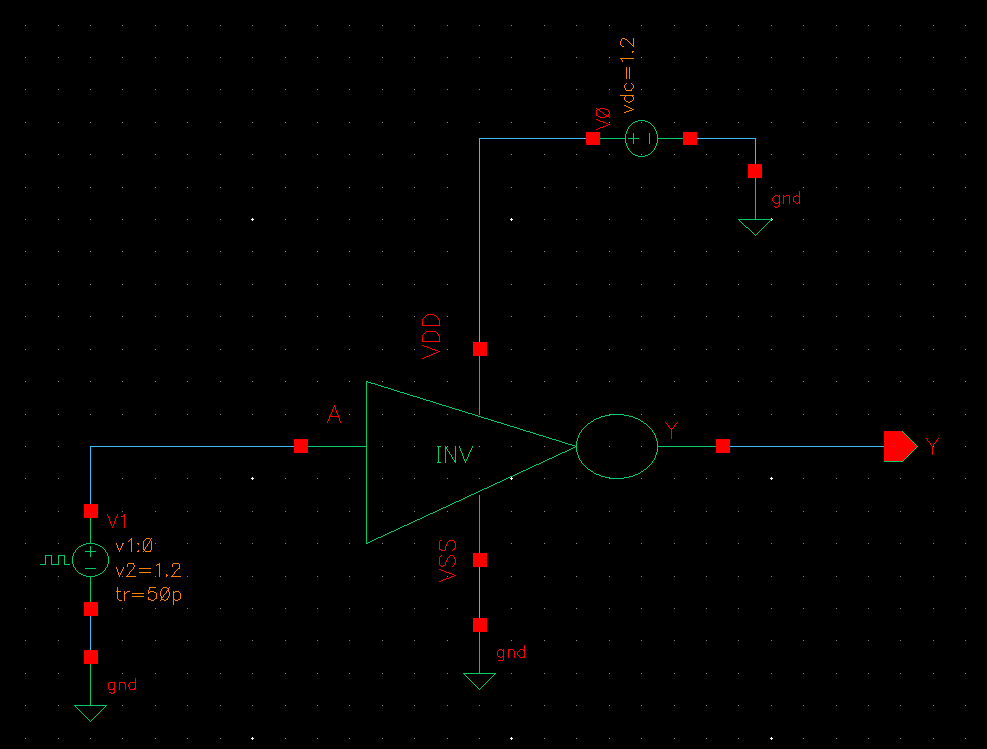 |

| Inverter Transient Waveform | Inverter Physical Layout |
| :---: | :---: |
| 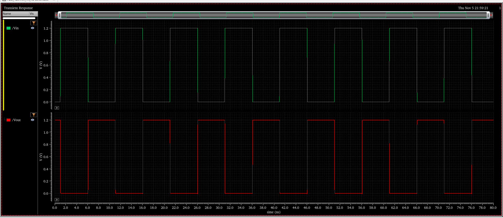 | 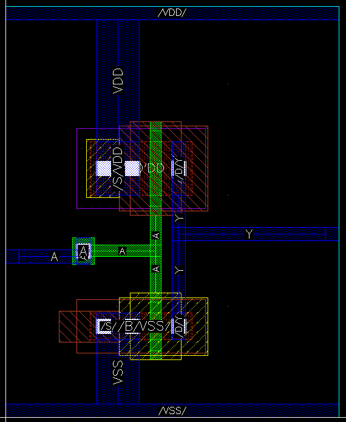 |

---

### 4.2 Bitwise Logic Gates (`AND2_CMOS`, `OR2_CMOS`, `XOR2_TG`)
* **Static CMOS AND (`AND2_CMOS` — 6T):** Constructed from a 4T CMOS NAND2 stage driving a 2T restoring inverter. Series NMOS transistors are scaled to $W_n = 480\text{ nm}$ to compensate for series stack resistance.
* **Static CMOS OR (`OR2_CMOS` — 6T):** Constructed from a 4T CMOS NOR2 stage (series PMOS scaled to $W_p = 960\text{ nm}$) driving a 2T restoring inverter.
* **Transmission Gate XOR (`XOR2_TG` — 6T):** Uses an input inverter (`A_bar`), a pass-supply inverter, and a complementary CMOS transmission gate to achieve full $0\text{ V}$ to $1.2\text{ V}$ swing in only 6 transistors without threshold-voltage ($V_t$) drop.
* **Combined Logic Verification:** All three gates were verified simultaneously in `LOGIC_GATES_TB` by sweeping inputs `A` (Period = `20 ns`, PW = `10 ns`) and `B` (Period = `10 ns`, PW = `5 ns`) across all four binary states (`00, 01, 10, 11`).
* **Physical Layout:** Implemented using Euler-path diffusion sharing between parallel/series pairs and detached outer substrate taps to minimize active area and parasitic drain capacitance.

| 6T CMOS AND Schematic | 6T CMOS AND Layout |
| :---: | :---: |
| 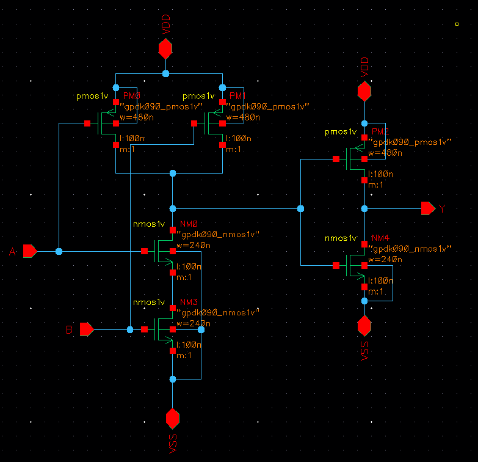 | 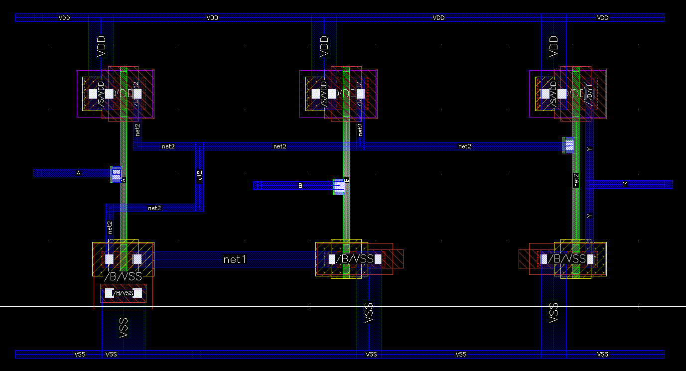 |

| 6T CMOS OR Schematic | 6T CMOS OR Layout |
| :---: | :---: |
| 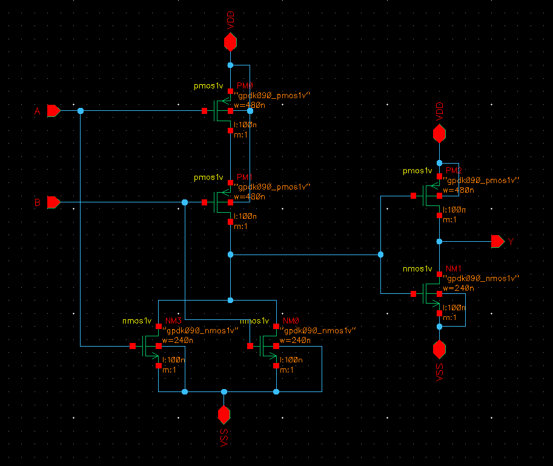 | 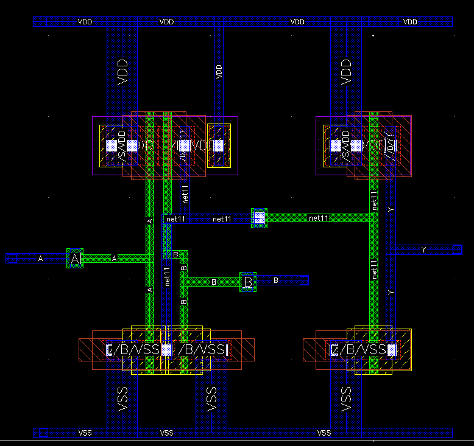 |

| 6T Transmission-Gate XOR Schematic | 6T Transmission-Gate XOR Layout |
| :---: | :---: |
| 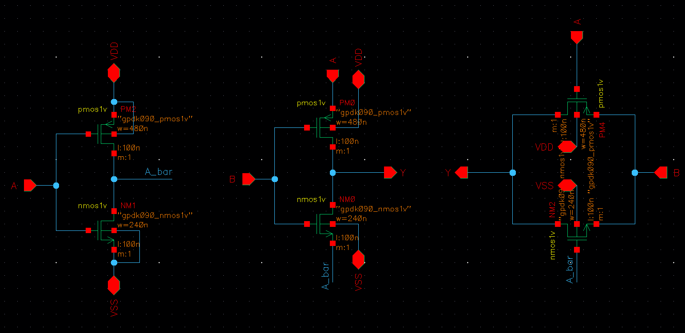 | 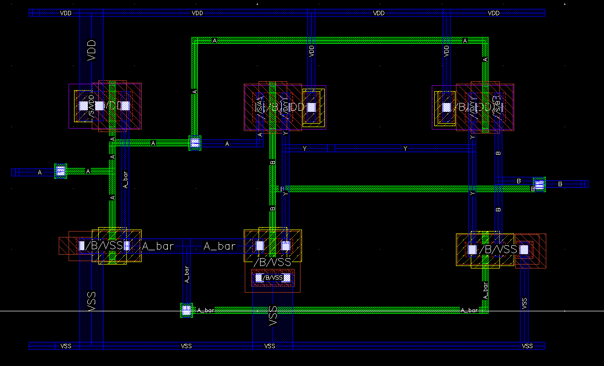 |

| Combined Logic Gates Testbench | Logic Gates Simulation Results |
| :---: | :---: |
| 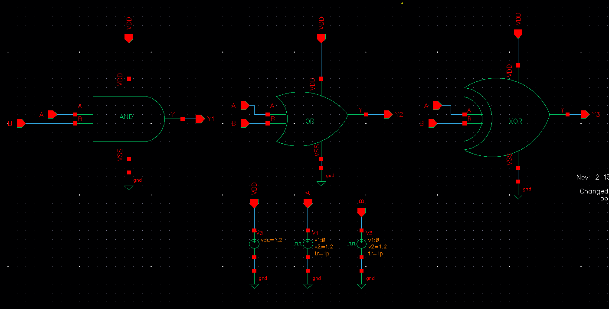 | 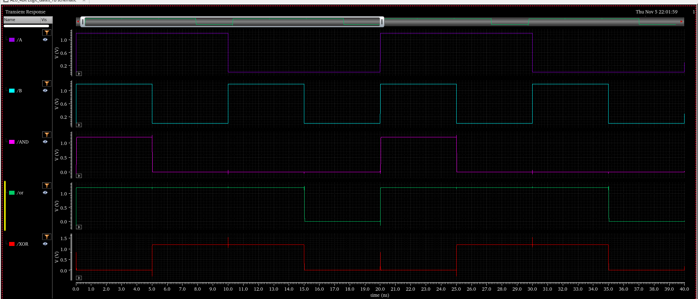 |

---

### 4.3 2x1 & 8x1 Transmission Gate Multiplexers (`MUX_2x1_TG`, `MUX_8x1_TG`)
* **2x1 TG Multiplexer (`MUX_2x1_TG` — 4T):** Built from two complementary CMOS transmission gates controlled by `S` and `S_bar` to pass either `D0` (`S = 0`) or `D1` (`S = 1`) with full rail-to-rail integrity.
* **8x1 TG Multiplexer Tree (`MUX_8x1_TG` — 34T):** A 3-stage binary reduction tree combining **7 instances of `MUX_2x1_TG`** (4 in Stage 1, 2 in Stage 2, 1 in Stage 3) and **3 select-line inverters (`INV_1X`)** for `S0`, `S1`, and `S2`.
* **Verification Methodology:** In `MUX_8x1_TB`, the 3-bit select bus `(S2, S1, S0)` steps through all 8 channels (`000` to `111`) in `10 ns` windows over an `80 ns` simulation while a high-frequency toggle pulse on the data inputs confirms clean switching on output `Y`.
* **Hierarchical Layout:** The 7 `MUX_2x1_TG` and 3 `INV_1X` layouts were abutted in a single standard-cell row with continuous horizontal `VDD`/`VSS` `Metal1` rails and `Metal2` select-bus routing.

| 2x1 TG MUX Schematic | 2x1 TG MUX Physical Layout |
| :---: | :---: |
| 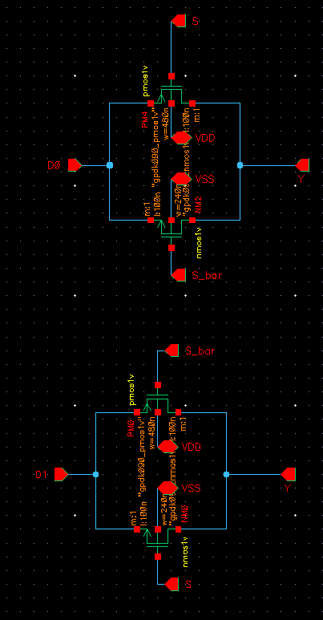 | 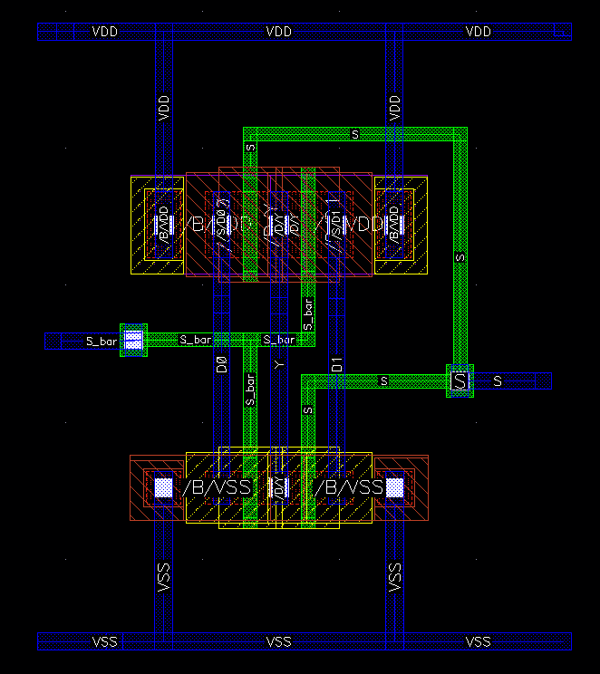 |

| 8x1 TG MUX Schematic | 8x1 TG MUX Testbench |
| :---: | :---: |
| 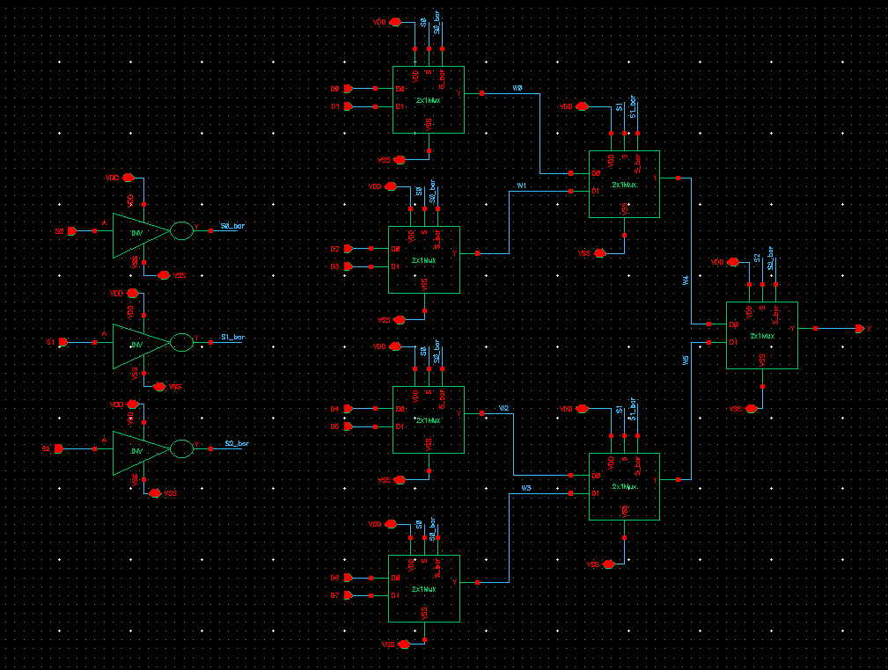 | 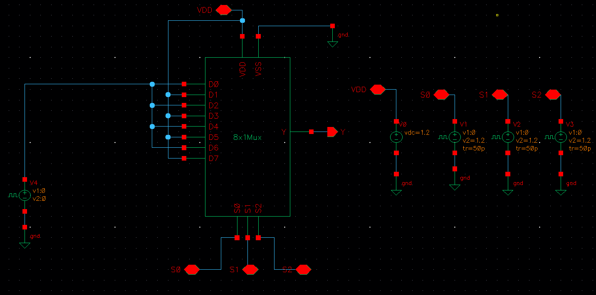 |

| 8x1 TG MUX Transient Results | 8x1 TG MUX Physical Layout |
| :---: | :---: |
| 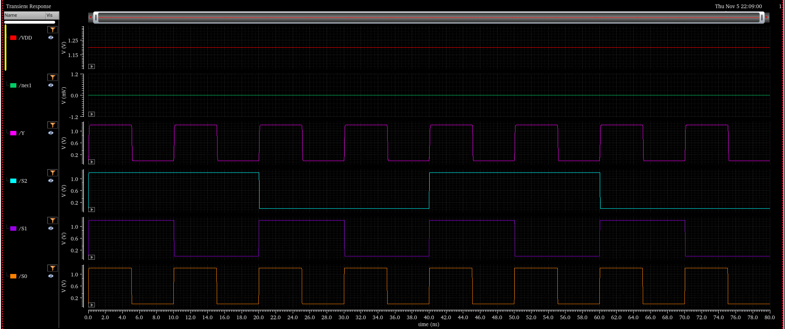 | 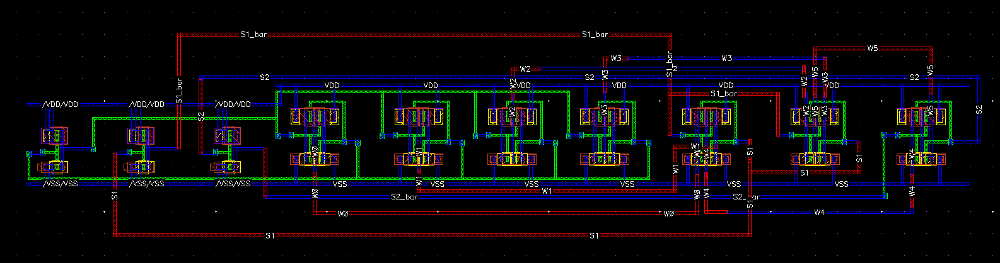 |

---

### 4.4 28-Transistor Mirror Full Adder (`FA_Mirror_28T`)
* **Circuit Architecture:** Instead of slower ripple-gate logic, this design implements a **symmetrical 28-transistor CMOS Mirror Adder**:
  * **10T Carry-Generation Stage (`PM0–PM4`, `NM0–NM4`):** Computes $\overline{C_{out}}$ directly from `A`, `B`, and `Cin` with only two series transistors in the critical carry path.
  * **14T Sum Stage (`PM5–PM11`, `NM5–NM11`):** Uses $\overline{C_{out}}$ alongside `A`, `B`, and `Cin` to compute $\overline{\text{Sum}}$.
  * **4T Restoring Output Inverters (`PM12–PM13`, `NM12–NM13`):** Invert $\overline{C_{out}}$ and $\overline{\text{Sum}}$ to drive full-swing `Cout` and `Sum` outputs.
* **Verification:** Tested across all 8 input combinations (`000` through `111`) of `(A, B, Cin)`, verifying that `Sum` asserts for odd parity (`001, 010, 100, 111`) and `Cout` asserts whenever two or more inputs are high (`011, 101, 110, 111`).
* **Euler-Path Layout:** Because the PMOS pull-up and NMOS pull-down networks are topologically identical (self-dual), all 14 transistor pairs share straight vertical polysilicon gates across 6 abutted diffusion blocks.

| 28T Mirror Full Adder Schematic | Full Adder Transient Results |
| :---: | :---: |
| 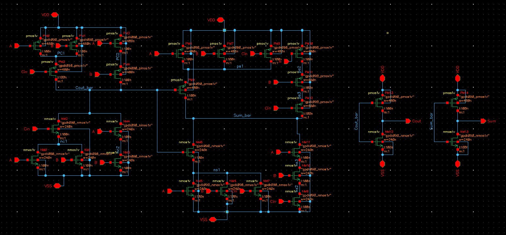 | 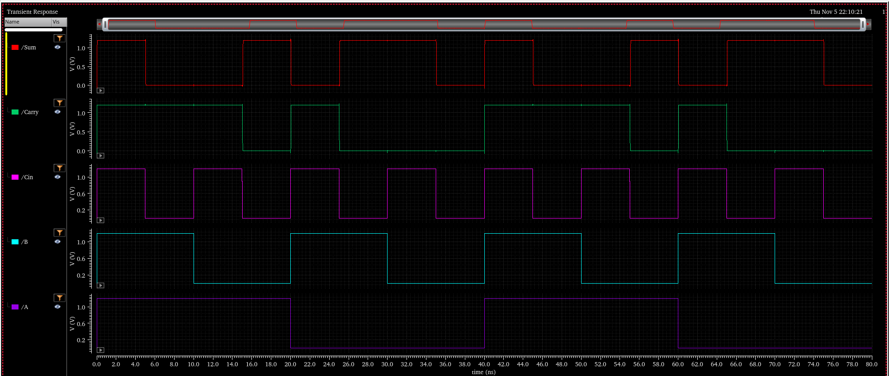 |

| 28T Mirror Full Adder Layout (Euler-Path Diffusion Sharing) |
| :---: |
| 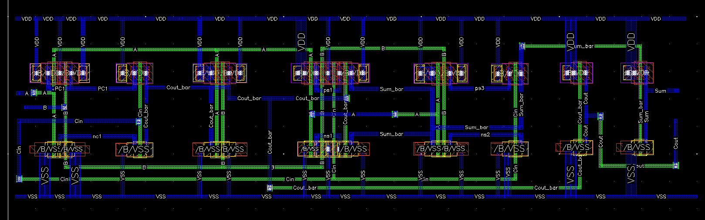 |

---

### 4.5 1-Bit ALU Slice (`ALU_1Bit` — 84 Transistors)
* **Bit-Slice Architecture:** Integrates `FA_Mirror_28T`, `AND2_CMOS`, `OR2_CMOS`, `XOR2_TG`, `INV_1X`, `MUX_8x1_TG`, and an input `XOR2_TG` (`B_mux`) for conditional $B$ inversion.
* **Adder Reuse for 2's Complement Subtraction (`001`):** Operand `B` passes through an XOR gate controlled by `S0` ($B_{\text{mux}} = B \oplus S_0$), and the adder's `Sum` output drives **both `D0` (`000` Add) and `D1` (`001` Sub)** on the 8x1 MUX:
  * When `S2 S1 S0 = 000` (`S0 = 0`), $B_{\text{mux}} = B$ and $C_{in} = 0 \implies \text{Sum} = A + B$.
  * When `S2 S1 S0 = 001` (`S0 = 1`), $B_{\text{mux}} = \overline{B}$ and $C_{in} = 1 \implies \text{Sum} = A + \overline{B} + 1 = A - B$.
* **80 ns All-Opcode Verification (`ALU_1Bit_TB`):** Swept `S2, S1, S0` from `000` to `111` in `10 ns` windows while cycling `(A, B)` through `00, 01, 10, 11` (in `2.5 ns` steps) inside every window:
  * `0–10 ns` (`000` Add): `ALU_OUT` = `0, 1, 1, 0`, `Cout` = `0, 0, 0, 1`
  * `10–20 ns` (`001` Sub): `ALU_OUT` = `0, 1, 1, 0`, `Cout` = `1, 0, 1, 1` (`Cout = 0` on `0 - 1` borrow)
  * `20–30 ns` (`010` AND): `ALU_OUT` = `0, 0, 0, 1`
  * `30–40 ns` (`011` OR): `ALU_OUT` = `0, 1, 1, 1`
  * `40–50 ns` (`100` XOR): `ALU_OUT` = `0, 1, 1, 0`
  * `50–60 ns` (`101` NOT): `ALU_OUT` = `1, 1, 0, 0` ($\overline{A}$)
  * `60–70 ns` (`110` Shift Left): `ALU_OUT` = `1, 1, 1, 1` (`Shift_L_In = VDD`)
  * `70–80 ns` (`111` Shift Right): `ALU_OUT` = `0, 0, 0, 0` (`Shift_R_In = VSS`)

| 1-Bit ALU Slice Schematic | 1-Bit ALU Testbench |
| :---: | :---: |
| 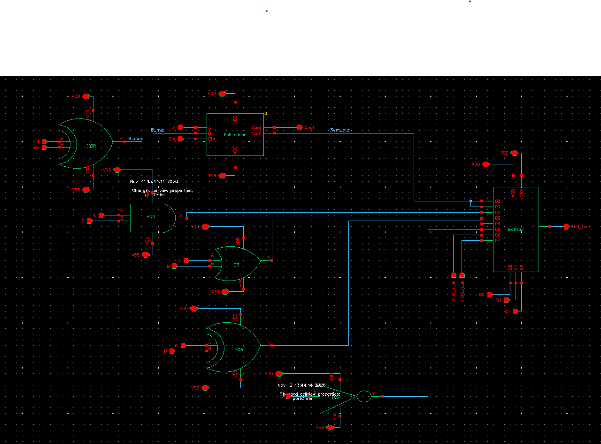 | 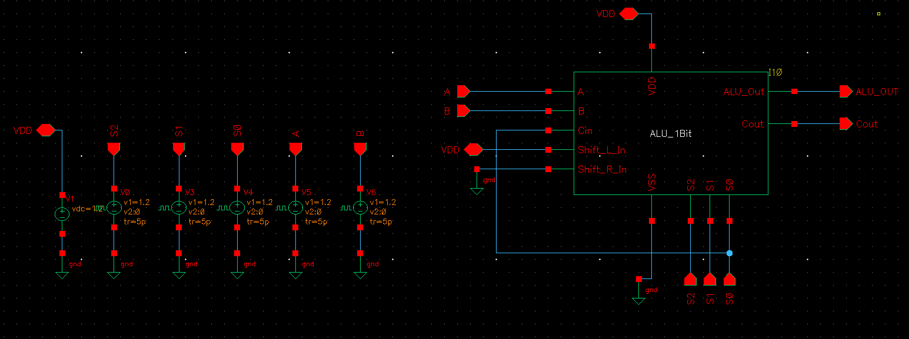 |

| 1-Bit ALU Transient Waveform (All 8 Opcodes) | 1-Bit ALU Macro Physical Layout |
| :---: | :---: |
| 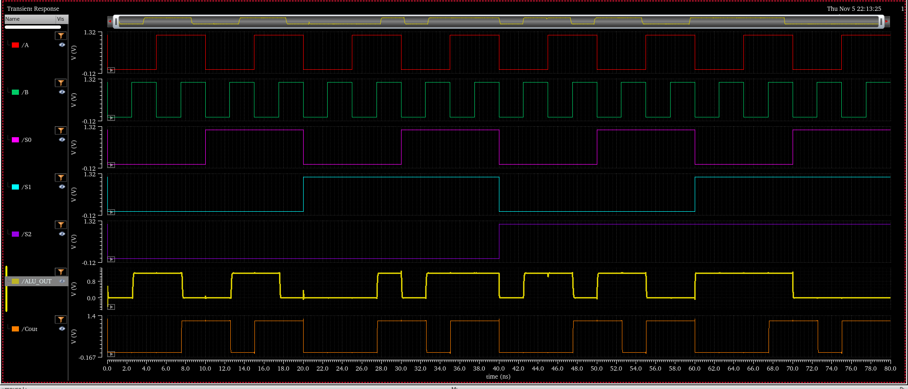 | 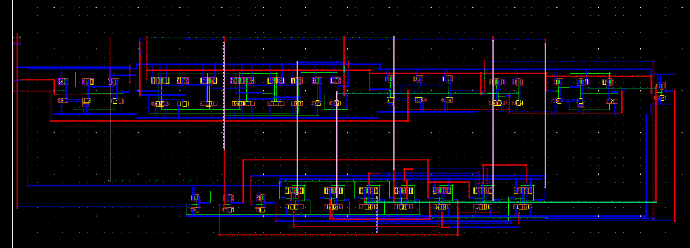 |

---

### 4.6 Top-Level 4-Bit Cascaded ALU (`ALU_4Bit` — 336 Transistors)
* **4-Slice Cascaded Datapath:** Instantiates four `ALU_1Bit` slices (`Slice 0` LSB to `Slice 3` MSB):
  * **Ripple-Carry Chain:** `Cin` enters Slice 0 (`Cin`), ripples serially through `Cout0 -> Cin1`, `Cout1 -> Cin2`, and `Cout2 -> Cin3`, and exits at Slice 3 (`Cout`).
  * **Zero-Transistor Neighbor Shift Routing:**
    * **Shift Left (`110`):** `Shift_L_In` receives `VSS` (`0`) on Slice 0, `A0` on Slice 1, `A1` on Slice 2, and `A2` on Slice 3 ($\text{ALU\_Out}[3:0] = A_2 A_1 A_0 0$).
    * **Shift Right (`111`):** `Shift_R_In` receives `A1` on Slice 0, `A2` on Slice 1, `A3` on Slice 2, and `VSS` (`0`) on Slice 3 ($\text{ALU\_Out}[3:0] = 0 A_3 A_2 A_1$).
* **4-Bit Simulation Verification (`ALU_4Bit_TB`):** Verified across all 8 opcodes (`0–80 ns`) using fixed 4-bit operands **$A[3:0] = 1010_2$ (Decimal 10)** and **$B[3:0] = 0011_2$ (Decimal 3)** with `Cin` tied to `S0`:

| Time Window | Opcode (`S2 S1 S0`) | Operation on $A = 1010_2 (10), B = 0011_2 (3)$ | Simulated `ALU_OUT[3:0]` | Simulated `Cout` | Status |
| :---: | :---: | :--- | :---: | :---: | :---: |
| **`0 – 10 ns`** | `000` (`Cin = 0`) | **Addition:** $10 + 3 = 13$ | **`1101`** ($13_{10}$) | `0` | **PASS** |
| **`10 – 20 ns`** | `001` (`Cin = 1`) | **Subtraction:** $10 - 3 = 7$ | **`0111`** ($7_{10}$) | `1` (No borrow) | **PASS** |
| **`20 – 30 ns`** | `010` | **Bitwise AND:** $1010_2 \ \& \ 0011_2$ | **`0010`** ($2_{10}$) | — | **PASS** |
| **`30 – 40 ns`** | `011` | **Bitwise OR:** $1010_2 \ \Vert{} \ 0011_2$ | **`1011`** ($11_{10}$) | — | **PASS** |
| **`40 – 50 ns`** | `100` | **Bitwise XOR:** $1010_2 \oplus 0011_2$ | **`1001`** ($9_{10}$) | — | **PASS** |
| **`50 – 60 ns`** | `101` | **Bitwise NOT ($\overline{A}$):** $\overline{1010_2}$ | **`0101`** ($5_{10}$) | — | **PASS** |
| **`60 – 70 ns`** | `110` | **Logical Shift Left ($A \ll 1$):** $1010_2 \ll 1$ | **`0100`** ($4_{10}$) | — | **PASS** |
| **`70 – 80 ns`** | `111` | **Logical Shift Right ($A \gg 1$):** $1010_2 \gg 1$ | **`0101`** ($5_{10}$) | — | **PASS** |

| 4-Bit Top-Level ALU Schematic | 4-Bit ALU Testbench |
| :---: | :---: |
| 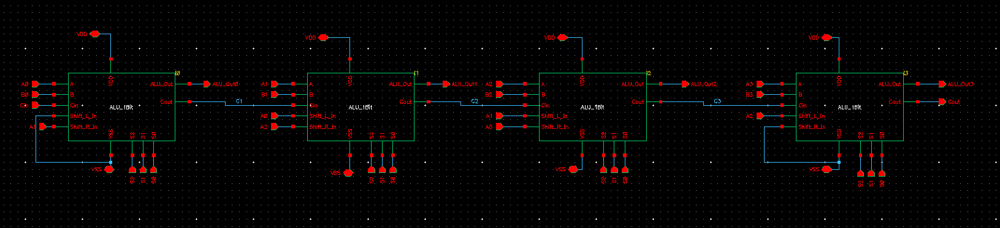 | 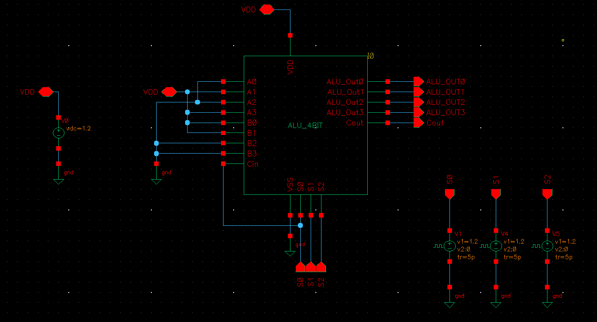 |

| 4-Bit ALU Transient Simulation Waveform | 4-Bit ALU Top-Level Physical Layout |
| :---: | :---: |
| 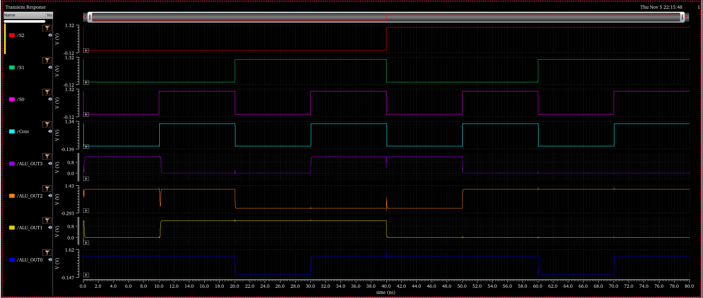 | 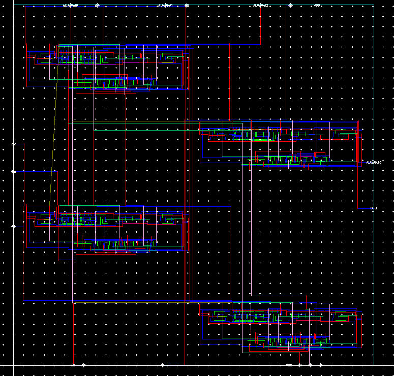 |

---

## 5. Repository Structure

```text
├── README.md
└── images/
    ├── INVERTER_SCH.png
    ├── INVERTER_Tb.png
    ├── INV_WAVEFORM.png
    ├── INV_LAYOUT.png
    ├── AND_SCH.png
    ├── AND_LAYOUT.png
    ├── OR_SCH.png
    ├── OR_LAYOUT.png
    ├── XOR_TG_SCH.png
    ├── XOR_LAYOUT.png
    ├── LOGIC_GATES_TB.png
    ├── LOGIC_GATES_RESULTS.png
    ├── MUX_2x1_SCH.png
    ├── MUX_2x1_LAYOUT.png
    ├── MUX_8x1_SCH.png
    ├── MUX_8x1_TB.png
    ├── MUX_8x1_RESULTS.png
    ├── MUX_8X1_LAYOUT.png
    ├── FULL_ADDER_SCH.png
    ├── FULL_ADDER_RESULTS.png
    ├── FULL_ADDER_LAYOUT.png
    ├── ALU_1_BIT.png
    ├── ALU_1_BIT_TB.png
    ├── ALU_1_BIT_RESULTS.png
    ├── ALU_1_BIT_LAYOUT.png
    ├── ALU_4_BIT_SCH.png
    ├── ALU_4_BIT_TB.png
    ├── ALU_4_BIT_RESULT.png
    └── ALU_4_BIT_LAYOUT.png
```
